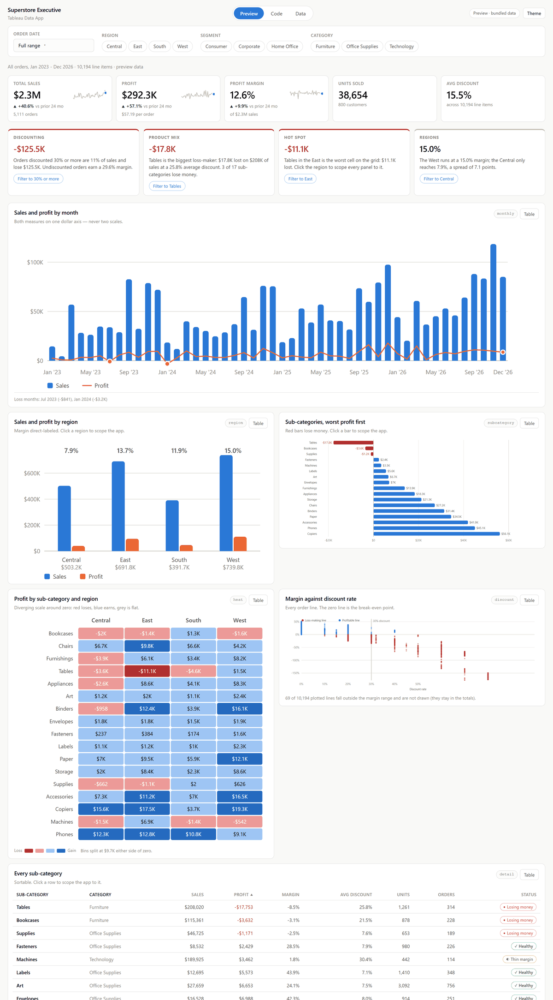
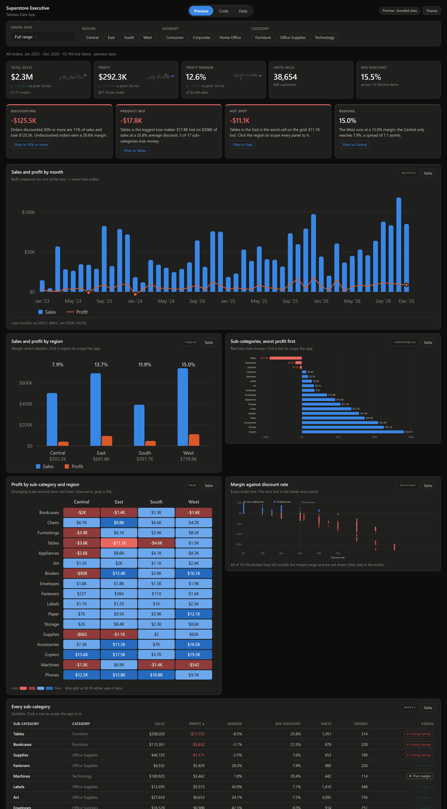

# Superstore Executive — Tableau Data App

An interactive data app built on the Superstore dataset, packaged to the Tableau
**Data Apps (Cloud-only Beta)** format: a Viz Extension whose web resources
travel inside the workbook, hosted and served by Tableau, querying a published
datasource at runtime.

Built following `https://tableau.github.io/extensions-api/docs/dataapps/`.



---

**Published and rendering on Tableau Cloud.** Live figures match the preview
exactly, and the top-bar badge reads *Live · Tableau* — so the runtime path
(`ds.queryAsync()` against the workbook's datasource) is confirmed working, not
just theorised.

---

## Getting it running

```bash
git clone https://github.com/datalabs89/tableau-dataapp-superstore.git
cd tableau-dataapp-superstore

pip install pandas openpyxl playwright
python -m playwright install chromium

python scripts/fetch_reference.py     # Tableau's sample + the beta API library
python scripts/build_all.py           # build everything
```

`build_all.py` runs the whole chain and stops at the first failure:

| Step | Output |
|---|---|
| `export_data.py` | aggregates + the expectations file the render check uses |
| `export_rows.py` | row-level bundle for the offline preview |
| `build_package.py` | `build/package/` and the `.twbx` |
| `build_preview.py` | `build/preview/` — served over HTTP for review |
| `build_singlefile.py` | `build/Superstore-Executive-preview.html` |

### You need the source workbook

This repo does **not** ship the data. Point the scripts at your copy of
`Sample - Superstore.xlsx` by any of:

```bash
python scripts/build_all.py --src "/path/to/Sample - Superstore.xlsx"
export SUPERSTORE_XLSX="/path/to/Sample - Superstore.xlsx"     # Windows: set
mkdir data && cp "/path/to/Sample - Superstore.xlsx" data/     # or just drop it here
```

With none of those, the scripts look in `~/Documents/Data`, `~/Desktop/Data`,
`~/Downloads`, then a shallow search of your user folder. If it still can't find
it, the error lists every place it looked.

## What you get

| Artifact | Path | Committed? |
|---|---|---|
| **`.twbx`** — the data app | `build/Superstore Executive.twbx` | no — built |
| **Single-file preview** — opens with no server | `build/Superstore-Executive-preview.html` | no — built |
| Expanded package | `build/package/` | no |
| Verification screenshots | `build/shots/` | no |

`build/` and `reference/` are gitignored: the first is derived, the second is
Tableau's own work fetched on demand (`fetch_reference.py`) rather than
redistributed here.


## The app

Executive overview, four editorial findings, six panels. Every figure is computed
from the same filtered slice, so the numbers always agree with each other.

- **KPI row** — sales, profit, margin, units, average discount, each with a
  half-over-half delta and a sparkline.
- **Findings** — four cards (discounting, product mix, hot spot, regional spread)
  recomputed per slice, each with a button that scopes the whole app.
- **Sales and profit by month** — both measures on **one** dollar axis, never two.
  Loss months carry markers and are named under the axis.
- **Sales and profit by region** — margin direct-labelled; click a region to filter.
- **Sub-categories, worst profit first** — loss bars in red; click to filter.
- **Profit by sub-category × region** — diverging scale around zero, value printed
  in every cell.
- **Margin against discount rate** — every order line; the 30% threshold marked.
- **Every sub-category** — sortable table; click a row to filter.

Filters live in one row above everything they scope. Each chart has a table view
(its WCAG-clean twin). Light and dark are both selected for their own surface —
the palette was validated against each mode's surface rather than inverted:

<details>
<summary>Dark mode</summary>



</details>

## Data

`Sample - Superstore.xlsx` — sheet `Orders`, **10,194 rows**, 2023-01-03 →
2026-12-30. Totals: sales **$2,326,534.35**, profit **$292,296.81**, margin
**12.56%**. Three of 17 sub-categories lose money; two months are loss-making.

## Build and verify

```bash
python scripts/build_all.py            # build everything
python scripts/build_all.py --verify   # build, then run all three checks
```

Individual steps, if you want them one at a time:

```bash
python scripts/fetch_reference.py       # Tableau's sample + the beta API library
python scripts/export_data.py           # aggregates + expectations
python scripts/export_rows.py           # row-level bundle (preview only)
python scripts/build_package.py         # -> build/package/ + .twbx
python scripts/build_preview.py         # -> build/preview/
python scripts/build_singlefile.py      # -> one self-contained .html
```

Requires Python 3 with `pandas`, `openpyxl` and `playwright` (Chromium
installed). No Node build step: the app ships as the source it is written in.

### The checks

```bash
python scripts/verify_package.py      # conformance to the packaging spec
python scripts/verify_opens.py        # the workbook opens in Tableau's own readers
python scripts/verify_render.py       # renders in Chromium; checks the figures
python scripts/verify_aggregation.py  # JS aggregation vs pandas, 9 slices
python scripts/verify_framed.py       # boots inside a sandboxed cross-origin frame
```

`verify_package.py` asserts the things that silently break a data app: identity
strings matching across `manifest.json` / `.trex` / `.twb`, the ZIP root layout,
HTTPS on the author URL, and — importantly — that the workbook **parses as XML**
and carries a live datasource pointing at the bundled data by a **relative** path.

That XML check is not decoration. An earlier revision of this project shipped a
`.twb` that every string check passed and that Tableau could not open at all: a
regex replacing the datasource had over-matched by 29 KB and swallowed the
element's closing tag. String matching can never establish that a file is
openable, so the check now reads the file, and
`scripts/test_gate_catches_old_bug.py` re-injects that exact malformation to
prove the gate still rejects it.

`verify_opens.py` goes further and hands the workbook to **Tableau's own Document
API**, reading the datasource and all 53 fields back out. It also drives Tableau
Desktop when it is installed.

`verify_render.py` reads the figures back out of the rendered DOM and compares
them against an independent recomputation from the source workbook — a chart that
draws the wrong number fails here. It also exercises the filters, reset, table
views, the theme toggle (asserting the SVG marks actually repaint), and
horizontal overflow at phone width.

`verify_framed.py` loads the app's real page inside a cross-origin sandboxed
iframe, which is how Tableau loads it — a page that works standalone can still
break in that context. Inside a frame the app correctly takes the Tableau path,
so this harness outwaits `initializeAsync()`'s 8s bound and asserts the app
either mounts or reaches its fallback with nothing blocked.

`verify_aggregation.py` runs the app's own aggregation for slices the render
check never visits, and cross-checks that every rollup sums to its total. This
matters because the published app aggregates on Tableau's side through
`queryAsync()`: if the JS path is right, the two engines are being asked for the
same numbers, so a divergence means a query is wrong.


## Runtime vs preview

Two backends, one output contract (`src/aggregate.js` + `src/store.js`):

- **`TableauStore`** — the published path. `ds.queryAsync()` (VizQL Data Service)
  runs the nine queries listed in the app's **Data** tab against the workbook's
  datasource, so Tableau does the aggregation and row-level security applies.
- **`PreviewStore`** — review path only. Aggregates bundled rows in JS.

Both resolve to the same `agg` shape, so every view is written once. The two
engines are independent on purpose: the preview proves the layout, the runtime
proves the app reads governed Tableau data. The badge in the top bar says which
one is live.

The workbook carries its data so it opens and publishes as a unit. That data is
the same 10,194 rows the preview uses, so the preview is a rehearsal rather than
a mock-up — but the runtime figures still come from Tableau, not from the
packaged file, which is why the two paths are verified separately.

`tableau.extensions.1.latest.min.js` is **1.19.0-pre.10**, the build that
exposes `queryAsync()` and `readMetadata()`. The SDK clone in `~/extensions-api/lib`
is 1.17.0 and does **not** have them.

## Before publishing

1. **Nothing to reconfigure.** The workbook connects to the data packaged inside
   it (`Data/Datasources/Sample - Superstore.xlsx`, a path relative to the
   `.twb`), so it opens with data and travels with it. There is no server name,
   site, or pre-existing published datasource to fill in.
2. **Publish** `Superstore Executive.twbx` to a Tableau Cloud project, via
   Tableau Desktop or Tableau MCP (`publish-workbook`).
3. **Enable the site controls.** Tableau Cloud → **Settings → Packages**:
   *Allow Packages on this Site*. No allowed origins are needed (nothing is
   loaded externally) and no REST paths (the app makes no `fetch()` calls).
4. **Check the Data pane.** Hover a component; its query highlights. Under
   *The Query*, `Authored` / `Executed` / `Data` show what ran and sample rows.

Permissions needed to view: View + full data query + API access to the workbook,
and Connect on the datasource it carries.

### What you can and cannot see locally

Data apps are a **Cloud-only beta**. Tableau's own documentation states it
plainly: *"The data Apps beta is available only on Tableau Cloud."*

In **Tableau Desktop** the `.twbx` opens correctly and its datasource loads —
verified, with screenshots — but **the extension pane is empty**. Desktop does
not host data apps, so there is nothing to render into it. This is not a
packaging defect: Tableau's own published Superstore sample behaves identically
when assembled the same way (`scripts/build_control_sample.py` reproduces it).

| You want to… | Use |
|---|---|
| See and click the app | `build/Superstore-Executive-preview.html` — opens in any browser, no server |
| Confirm the workbook is sound | `build/Superstore Executive.twbx` in Tableau Desktop |
| See the **published** app | `scripts/publish_to_cloud.py --project <name> --overwrite` |

The browser preview runs the identical app code off the same 10,194 rows, and
its figures are verified against a separate recomputation. The runtime path —
`ds.queryAsync()` talking to Tableau — was confirmed separately on Cloud: the
published view renders `Live · Tableau` with totals identical to the preview.

### Publishing

```bash
export TABLEAU_SERVER=https://<pod>.online.tableau.com
export TABLEAU_SITE=<site content url>
export TABLEAU_PAT_NAME=<token name>
export TABLEAU_PAT_VALUE=<token secret>

python scripts/publish_to_cloud.py --list-projects
python scripts/publish_to_cloud.py --project "Default" --overwrite
```

Credentials come from the environment only — never written to the repo, never
passed as arguments, so they stay out of shell history and the process table.

One thing the API cannot tell you: whether the site has **Settings → Packages →
Allow Packages on this Site** enabled. Without it the workbook publishes fine and
the pane stays empty, which looks identical to a packaging fault.

## Layout

```
dataapp/            the app, exactly as shipped
  index.html        classic <script> tags, dependency order, no bundler
  src/
    constants.js    vocabularies + the validated palette (light & dark)
    aggregate.js    slice -> every aggregate shape (shared by both backends)
    store.js        PreviewStore | TableauStore | VDS shaping
    primitives.js   SVG marks: bar/column paths, ticks, gridlines
    chart-*.js      monthly, region, rank, heat, scatter
    kpi.js findings.js detail-table.js filter-bar.js card.js tooltip.js
    app.js main.js  controller and entry point
scripts/            build + verification
reference/          the official Tableau sample and PDFs used as the spec
```

## Color

Palette from the `dataviz` skill, validated with `validate_palette.js` against the
surface each mode actually renders on:

- categorical slots 1–4: **ALL CHECKS PASS** light (worst adjacent CVD ΔE 9.1) and
  dark (8.4)
- diverging 4-bin profit scale: CVD + normal-vision PASS both modes; the two light
  steps carry a contrast WARN, whose required relief is met by printing the value
  in every heat cell **and** shipping a table view.

Do not hand-edit a hex. Re-run the validator instead.

## Known limits

- Cloud-only beta. Not Desktop, not Server.
- **One editor per app**; sharing is view-only.
- Only SDMs, DLOs, and DMOs in the default data space (Tableau Next variant); this
  app uses a plain published datasource.
- The scatter is bounded to 5,000 rows at runtime and says so on the card; totals
  and every other panel use the full set via aggregate queries.
- `Returns` is not surfaced — Superstore's returns sheet has no discount/margin
  join worth showing in an executive overview.

## Review without a server

`build/Superstore-Executive-preview.html` is the same app inlined into one file
— stylesheet, scripts, and all 10,194 rows — so it opens straight from disk with
no web server:

```
start "" "build\Superstore-Executive-preview.html"
```

Built by `scripts/build_singlefile.py`, which reads the same `dataapp/` sources
the package ships, so the reviewable page cannot drift from the published one.
